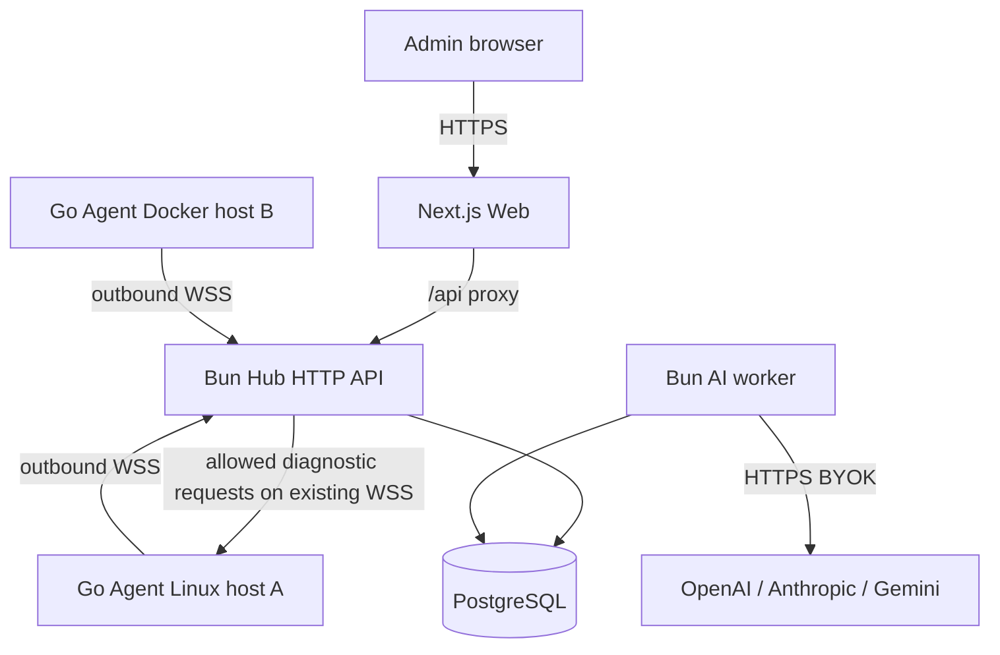
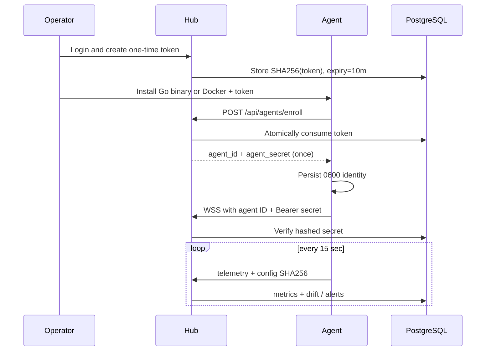
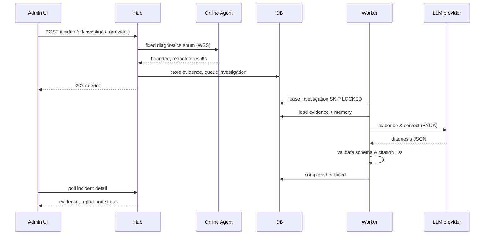

# Architecture — OpsPilot

## Decisions

- **One repository**, separate runnable apps, modular monolith Hub; agent uses Go.
- **Bun-first** TypeScript Hub / Worker; Next.js App Router UI.
- **Outbound agent connection** WSS to Hub, no inbound SSH.
- **Single-admin** application; agent identities and enrollment separate from admin session.
- **PostgreSQL-first**, no Redis/Kafka; full-text resolution memory in first version.
- **LLM is advisory**, never part of required telemetry path.

## System context

## Agent deployment

## Investigation

## Source-of-truth data

- Agent telemetry is **not** authoritative about causes; metrics are symptoms.
- Config hash change is a fact about bytes, **not** proof of causation.
- `evidence.id` is a trusted server-minted reference; external log content is untrusted.
- Human resolution is authoritative for the incident memory record, but remains a fallible prior in future cases.

## Failure modes and required behavior

| Failure | Expected behavior |
|---|---|
| Agent offline | Dashboard shows offline; existing telemetry/incident data readable; no live diagnostics |
| PostgreSQL unavailable | Hub health 503; API may error; agents reconnect, starter does not spool metrics |
| LLM provider unavailable | Investigation failed with error; monitoring continues |
| Missing provider API key | UI provider absent; no external calls |
| Agent credentials invalid | WSS denied; credentials never in URL query |
| Diagnostic timeout | Worker can use partial evidence; no invented successful results |
| File unreadable / symlink / >1MB | Skip hash; log absence must not be treated as drift |

## Evolution

1. Split route definitions, add deterministic incident correlation IDs and incident state transitions.
2. Implement durable agent-side queue or WAL for metrics under network loss.
3. Add retention/downsampling, cardinality controls, indexed time-series store if needed.
4. Add separate agent capability discovery; forbid dispatch of unsupported tools.
5. Add pgvector semantic memory when measured FTS recall is insufficient; embeddings provider can differ from reasoning provider.
6. Scale Hub gateway nodes only after introducing shared ephemeral connection routing and distributed alert state (current in-memory maps are one-Hub only).
