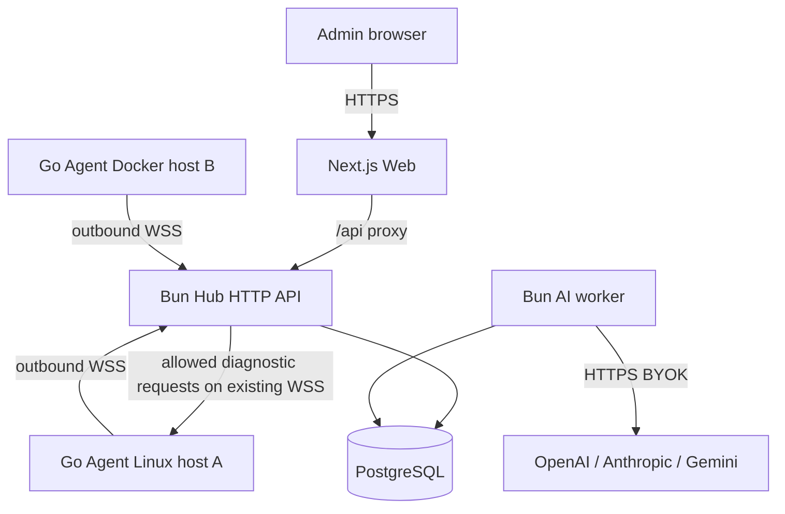
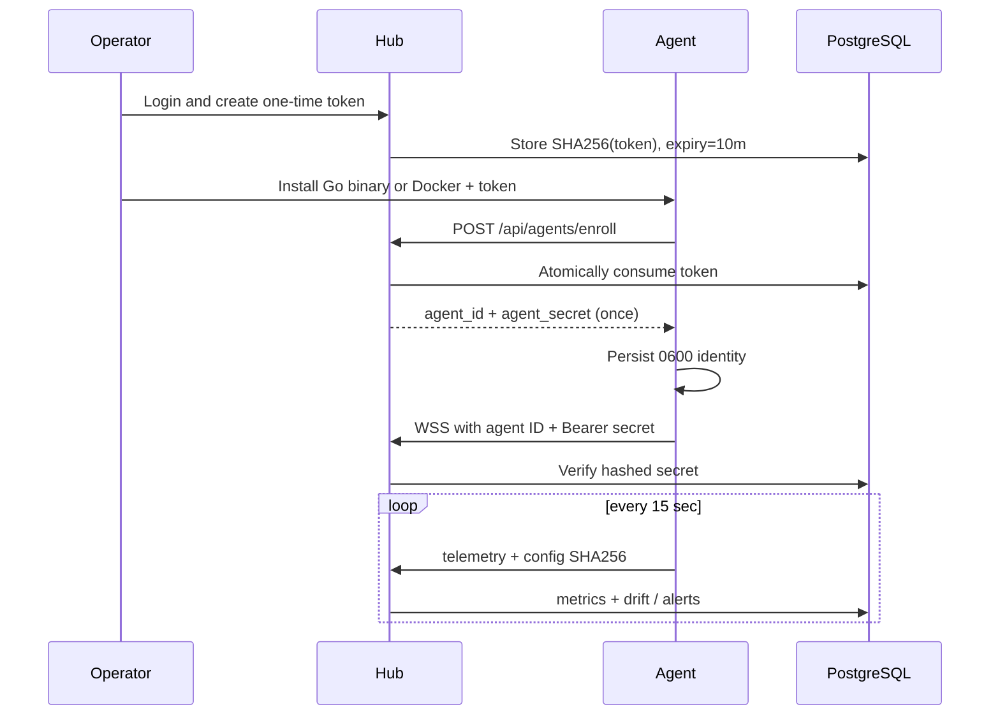
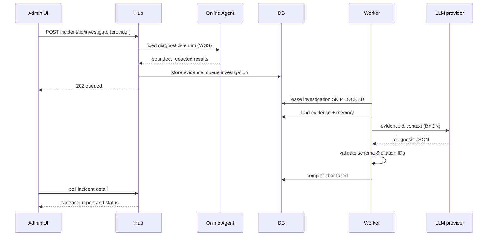

# Architecture — OpsPilot

## Decisions

- **One repository**, separate runnable apps, modular monolith Hub; agent uses Go.
- **Bun-first** TypeScript Hub / Worker; Next.js App Router UI.
- **Outbound agent connection** WSS to Hub, no inbound SSH.
- **Single-admin** application; agent identities and enrollment separate from admin session.
- **PostgreSQL-first**, no Redis/Kafka; full-text resolution memory in first version.
- **LLM is advisory**, never part of required telemetry path.

## System context



## Agent deployment



## Investigation



## Source-of-truth data

- Agent telemetry is **not** authoritative about causes; metrics are symptoms.
- Config hash change is a fact about bytes, **not** proof of causation.
- `evidence.id` is a trusted server-minted reference; external log content is untrusted.
- Human resolution is authoritative for the incident memory record, but remains a fallible prior in future cases.
- Host connectivity, workload process state and endpoint reachability are independent signals. Future HTTP check results must identify the actual probe location/time; neither a running process nor a correlated CPU spike establishes availability or root cause.

## Failure modes and required behavior

| Failure | Expected behavior |
|---|---|
| Agent offline | Dashboard shows offline; existing telemetry/incident data readable; no live diagnostics |
| PostgreSQL unavailable | Hub health 503; API may error; agents reconnect, starter does not spool metrics |
| LLM provider unavailable | Investigation failed with error; monitoring continues |
| Missing provider API key | UI provider absent; no external calls |
| Agent credentials invalid | WSS denied; credentials never in URL query |
| Diagnostic timeout | Worker can use partial evidence; no invented successful results |
| File unreadable / symlink / >1MB | Skip hash; log absence must not be treated as drift |

## Evolution

1. Split route definitions, add deterministic incident correlation IDs and incident state transitions.
2. Implement durable agent-side queue or WAL for metrics under network loss.
3. Add retention/downsampling, cardinality controls, indexed time-series store if needed.
4. Add separate agent capability discovery; forbid dispatch of unsupported tools.
5. Add pgvector semantic memory when measured FTS recall is insufficient; embeddings provider can differ from reasoning provider.
6. Scale Hub gateway nodes only after introducing shared ephemeral connection routing and distributed alert state (current in-memory maps are one-Hub only).

The [Fleet & services dashboard plan](ROADMAP.md#fleet-services-dashboard-delivery-planned) stays within these module boundaries: Go agent for opt-in workload inventory, Hub for authenticated configuration/read models and Worker for bounded scheduled HTTP checks. This is a planned extension, not a shipped probe service or a reason to add another independently deployed app. See the [data boundary](BACKEND-DESIGN.md#fleet-services-data-boundary-planned) and [security prerequisites](SECURITY.md#planned-inventory-and-endpoint-monitoring).

## Architectural Decisions (ADR)

### ADR-0001: Bun-native Hub + `Bun.SQL`, not Fastify in first scaffold

- **Status:** Accepted for starter
- **Context:** Bun is explicitly preferred; small product, WSS agent gateway and PostgreSQL required. A previous draft proposed Fastify.
- **Decision:** Use native `Bun.serve` HTTP/WebSocket and `Bun.SQL` to reduce dependencies and keep direct Bun runtime usage; retain typed modules and route separation.
- **Consequences:** Very small dependency footprint; explicit Bun runtime requirement. Manual routing/validation is more work; promote to Hono/Fastify only when routes/validation become unwieldy. Do not claim Fastify integration is present.
- **Revisit trigger:** >50 endpoints, repeated schema boilerplate, complex middlewares or broader developer collaboration.

### ADR-0002: Agent-initiated WSS and read-only tools

- **Status:** Accepted
- **Context:** Small VPS/homelab hosts should not expose inbound SSH or new agent API ports.
- **Decision:** Agent enrolls once over HTTPS, persists a 256-bit credential, initiates WSS outbound, sends metrics and receives enumerated diagnostic requests. Each request has ID, timeout and local service allowlist.
- **Consequences:** NAT-friendly, no SSH credentials in Hub. Agent offline means no live checks; add durable queue/reconnect for telemetry in future. Agent credentials must be rotated/revoked eventually.
- **Rejected alternatives:** inbound SSH as primary transport; remotely executing arbitrary shell; hub polling an open inbound agent port.

### ADR-0003: PostgreSQL-first storage and incident memory

- **Status:** Accepted
- **Context:** Small scale with 1–20 hosts, limited ops budget, RAG capability desired, no need for extra data services on day one.
- **Decision:** PostgreSQL for events, metrics, config hashes and human-resolved memory. Initial memory retrieval via built-in full-text search. No Redis, Loki, VictoriaMetrics or pgvector service in initial scaffold.
- **Consequences:** Easy local deployment. Large time-series volume requires retention/partitioning; FTS misses semantic similarities. Add pgvector/hybrid retrieval behind evaluation gate; external embedding provider may differ from reasoning provider.

## Repository Structure & Module Ownership

```text
opspilot/
├── README.md
├── AGENTS.md                    # Coding-agent rules and invariants
├── CHANGELOG.md                 # Release and unreleased change log
├── DESIGN.md                    # Implemented visual system; not backend design
├── package.json                 # Bun workspaces + developer scripts
├── bun.lock                     # Reproducible TS workspace dependencies
├── .gitattributes               # LF text files on Windows and Linux
├── .impeccable/design.json      # Visual metadata and component previews
├── .env.example                 # No real secrets
├── compose.yaml                 # Local DB / optional full stack
├── apps/
│   ├── web/
│   │   ├── AGENTS.md
│   │   ├── app/
│   │   │   ├── layout.tsx
│   │   │   ├── page.tsx         # Dashboard, login, incidents, memory
│   │   │   ├── globals.css      # Base stylesheet importing tokens and styles/
│   │   │   ├── tokens.css       # Semantic runtime design tokens
│   │   │   ├── styles/          # Modular CSS partials
│   │   │   └── design-system/
│   │   │       ├── page.tsx     # Public reference route and metadata
│   │   │       ├── catalog.tsx  # Synthetic interactive component catalog
│   │   │       └── design-system.module.css
│   │   ├── components/
│   │   │   ├── ui.tsx           # Shared native React controls
│   │   │   ├── brand-mark.tsx   # Inline Horizon Gauge SVG brand mark
│   │   │   └── host-workspace.tsx # Fleet & services host table and inspector
│   │   ├── public/              # Web & PWA favicons, app icons, manifest
│   │   ├── next.config.ts       # /api reverse-proxy rewrite to Hub
│   │   ├── package.json
│   │   └── tsconfig.json
│   ├── hub/
│   │   ├── src/
│   │   │   ├── index.ts         # HTTP router and Bun.serve WebSocket
│   │   │   ├── auth.ts          # Signed admin cookie
│   │   │   ├── db.ts            # Bun.SQL connection + audit
│   │   │   ├── agents.ts        # Enrollment, WSS sessions, diagnostics
│   │   │   └── incidents.ts     # Thresholds, config drift, evidence
│   │   ├── package.json
│   │   └── tsconfig.json
│   └── worker/
│       ├── src/index.ts         # Bounded sequential job runner
│       ├── package.json
│       └── tsconfig.json
├── packages/
│   ├── contracts/
│   │   └── src/index.ts         # Shared wire types + validators
│   └── ai/
│       └── src/index.ts         # OpenAI/Anthropic/Gemini adapters
├── agent/
│   ├── cmd/opspilot-agent/main.go
│   ├── internal/agent/
│   │   ├── agent.go             # Enrollment, /proc metrics, safe tools
│   │   └── agent_test.go
│   ├── go.mod
│   ├── go.sum
│   └── Makefile
├── infra/
│   ├── db/001_init.sql
│   ├── docker/Dockerfile.{hub,worker,web,agent}
│   └── systemd/{opspilot-agent.service,agent.env.example}
├── tools/
│   ├── migrate.ts
│   ├── hash-password.ts
│   └── seed-demo.ts             # Opt-in local demo data seeder
├── tests/
│   ├── contracts.test.ts
│   ├── seed-demo.test.ts        # Seed safety negative tests
│   └── incident-fixtures/       # Synthetic annotated AI benchmark fixtures
├── docs/
│   ├── PRD.md, ARCHITECTURE.md, BACKEND-DESIGN.md, UI-UX.md
│   ├── DATABASE.md, API.md, AI-DESIGN.md, SECURITY.md
│   ├── DEPLOYMENT.md, DEVELOPMENT.md, TESTING.md, ROADMAP.md
│   ├── assets/
│   │   ├── fleet-services-reference.png
│   │   └── logo/                # Master SVG symbol and lockup assets
│   └── runbooks/incident-502.md
└── .github/workflows/{checks,packages,release}.yml
```

### Boundaries and ownership

- `web` never receives provider API keys, agent secrets or direct DB credentials. It requests `/api/*` from Hub via Next rewrite.
- The public `/design-system` route uses only synthetic examples and local state, without `/api` requests. Visual changes belong in shared tokens/primitives; root `DESIGN.md` records their contract, while `docs/BACKEND-DESIGN.md` records backend implementation.
- `hub` performs authentication, rate/size admission, agent identity validation and state mutation; it **does not** directly call the external LLM.
- `worker` only leases queued investigations and reads already-collected evidence. It never has direct reachability to agent WS sessions.
- `agent` uses fixed tools; no arbitrary command registry or plugin execution in starter.
- `contracts` own wire types, public interfaces and validated enum values. Keep circular dependencies out.
- `ai` own provider-specific request formats, evidence citations, redaction, schema checks; it must not import HTTP server internals.
- `infra` owns packaging/deployment; `docs` own decisions and acceptance criteria.

### Evolving the structure

When modules grow, split hub's `index.ts` routes into `src/modules/{auth,hosts,incidents,agents,telemetry}/routes.ts`, put SQL in repositories, and add `packages/db` for typed queries/migrations. Do **not** introduce microservices merely to create more folders. A source directory is not a deployment unit.
