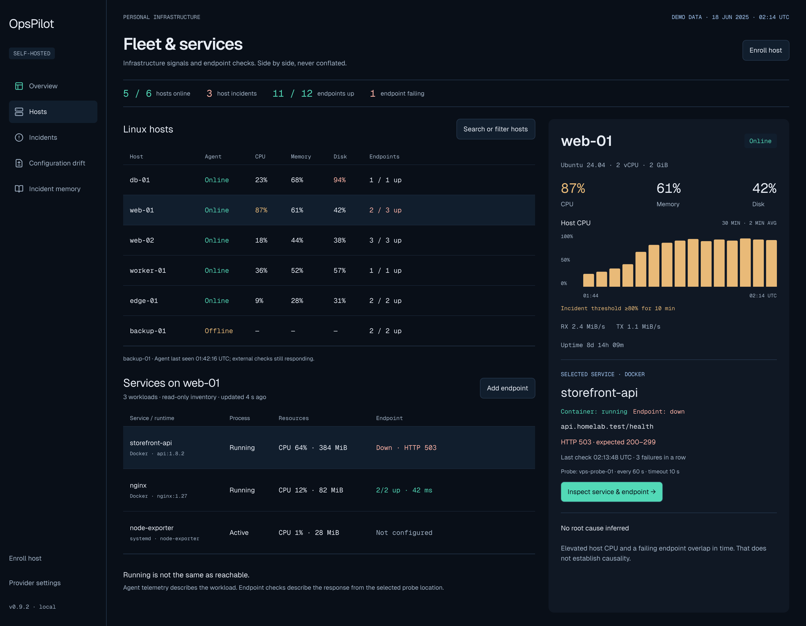
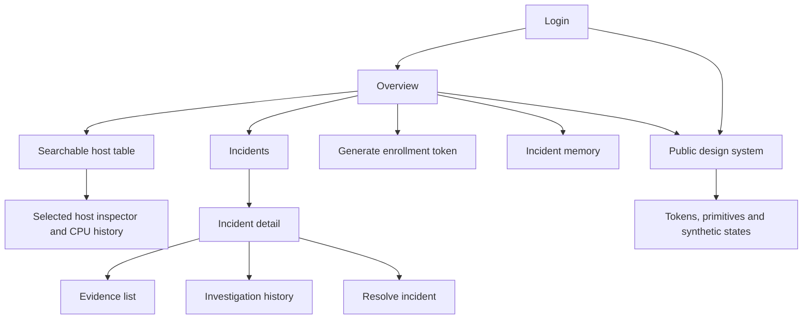

# Interface & UX Design Specification

## Design principles

- **Operational clarity:** show host telemetry, workload state and endpoint checks side by side without conflating them; AI insights are advisory rather than primary source of truth.
- **Evidence is visible:** present both model summary and the diagnostic records it claims to cite.
- **Progressive disclosure:** basic resources first, drill down to diagnostics and memory.
- **Safe defaults:** no auto-remediate button, no raw secret upload, clear provider configuration status.

## Implemented visual system

The canonical visual reference is [root DESIGN.md](../DESIGN.md), extracted from `apps/web/app/tokens.css` and the native React primitives in `apps/web/components/ui.tsx`. Global styling lives in `apps/web/app/globals.css`; `.impeccable/design.json` contains preview and metadata extensions, not a second runtime theme. The backend architecture remains in [docs/DESIGN.md](DESIGN.md).

| Token | Value / use |
|---|---|
| Canvas | `#090f18` |
| Surfaces | `#101824` panel, `#111e2d` raised control, `#091421` input |
| Borders | `#233449` structural, `#526b82` interactive |
| Accent | `#52d9b7`, hover `#79efd3`, foreground `#092521` |
| Success | `#75dec1` on `#142e2a` |
| Warning | `#e9ba78` on `#302719` |
| Danger | `#ffb4a7` on `#371c22` |
| Information | `#a5c9f5` on `#182a40` |
| Text | `#e8edf5`, secondary `#a3b4c7` |
| Body | system UI sans, 14px at the 16px root; monospace for code and measurements |
| Radius | 6px controls, 10px nested surfaces, 14px panels |
| Spacing | quarter-rem steps: 1–8, 10, 12 |
| Layout | host slice: 208px rail and table/inspector grid ≥1280px; inspector stacks below that; navigation moves above content at 700px |

### Public component catalog

`/design-system` is available without signing in, including while the Hub is unavailable. Links appear on the loading/login surfaces and in dashboard navigation. It is a self-contained reference with synthetic evidence, semantic swatches, actual shared primitives, a keyboard-operated meter slider, local form validation, disabled/loading examples and an evidence disclosure. It makes no API calls and does not persist settings or expose production telemetry. The local form explicitly reports that no settings were saved.

Shared controls use native labels and inputs, visible 2px mint keyboard focus, explicit error descriptions and invalid states, disabled/busy feedback, and reduced-motion overrides. The catalog adds a skip link and section anchors; its sticky index becomes wrapping inline links at 720px, while its four-column palette becomes three columns at 1000px and two at 720px. These implemented provisions do not claim a completed screen-reader audit.

The catalog and dashboard preserve the distinction between measured records, advisory AI hypotheses and human-confirmed resolution. A missing/non-finite measurement is unavailable, not a zero-value bar. Status text accompanies semantic color.

## Fleet & services dashboard contract (target)

**Status:** approved design direction from the supplied reference. The host-only table/inspector slice is implemented; workload inventory, HTTP monitoring and the complete navigation/metadata contract remain planned. The palette, shared primitives and evidence-first rules remain unchanged.

The reference is authoritative for composition and information hierarchy, not its sample identities, version, date, telemetry, thresholds or probe configuration. Any reproduction with synthetic values must display `Demo data`; live views must show actual freshness. Do not copy the example's 2025 date or `v0.9.2` as product metadata.

### Hierarchy and navigation

1. **Left rail:** OpsPilot and a `Self-hosted` context label; Overview, Hosts, Incidents, Configuration drift and Incident memory. Place Enroll host and Provider settings below the main destinations. Distinct destinations are target information architecture, not existing routes; never ship inert navigation.
2. **Header:** context eyebrow, `Fleet & services` title, “Infrastructure signals and endpoint checks. Side by side, never conflated.”, refresh/time context and a secondary `Enroll host` action.
3. **Summary strip:** hosts online / enrolled hosts, open host incidents, endpoints up / configured endpoints, and endpoints failing. Keep the counts inline with thin separators, not four large cards. Unknown/stale checks remain in the configured total but are not counted as up or failing; expose their count when nonzero. No configured checks means `No endpoints configured`, not `0 / 0 healthy`. Counts must state whether they cover the fleet or a filtered subset; never treat the current capped API list as a complete fleet total.
4. **Main list:** `Linux hosts` with search/filter, then columns Host, Agent, CPU, Memory, Disk and Endpoints. Show a clear selected row. An offline host may still have reachable endpoints; describe last agent contact below the list without overwriting independently fresh endpoint results.
5. **Selected-host inventory:** `Services on {hostname}`, workload count, read-only inventory label and collection timestamp, with a secondary `Add endpoint` action. Columns are Service / runtime, Process, Resources and Endpoint. Include Docker image/tag or systemd unit when collected. No inventory capability or permission is `Inventory unavailable`, not `0 workloads`.
6. **Context inspector:** selected host name and agent state; OS/capacity when available; CPU/memory/disk values; timestamped CPU history; RX/TX and uptime when measured; then selected service name/runtime, independent process and endpoint states, target, observed response versus expected response, last check, consecutive failures, probe location, interval and timeout. End with `Inspect service & endpoint` and an explicit inference boundary.

Keep lists flat on the canvas and the inspector on one tonal surface. Use the root [design contract](../DESIGN.md#layout) for target sizing and responsive behavior. Sans-serif headings and labels provide hierarchy; monospace identifies hosts, runtime metadata, measurements and timestamps. Amber/coral mark the relevant measured condition, not an entire host row merely because one endpoint failed.

### Independent signal contract

| Signal | Source and required context | Meaning / unavailable behavior |
|---|---|---|
| Agent connectivity | Hub connection/last-seen state and timestamp | `Online` or `Offline`; connection is not application health. Retained samples must be labeled historical/stale. |
| Host utilization | Agent sample, units and observation time | CPU, memory and disk describe the host, not the selected service. Missing samples use `—` with `No measurement`; stale samples never look live. |
| Workload process | Supported, explicitly enabled read-only Docker/systemd inventory and collection time | `Running`/`Active`, `Stopped`/`Failed`, or `Unknown`; process state does not prove that an endpoint responds. |
| Workload resources | Per-workload measurement and scope | Separate service CPU/memory from host percentages. Missing capability, denied permission or unsupported runtime is unavailable, not zero. |
| Endpoint reachability | Independent HTTP check from a named probe, target, time, expected response and observed result/error | `Up`, `Down`, `Unknown` or `Not configured`; only a fresh failed check establishes `Down`. Timeout, DNS and TLS failures have explicit reasons. |
| Root cause | Cited investigation or human resolution | Default `No root cause inferred`. Temporal overlap alone is not causality; AI hypotheses and human-confirmed resolutions remain separately labeled. |

`Not configured` means no endpoint is associated with that service. `Unknown` means a configured check has no usable/fresh result. Multiple endpoints show `up / configured` plus failing/unknown counts as needed; details enumerate the checks rather than choosing an arbitrary result. Reachability is always from the displayed probe location, not a promise of global availability.

The reference case must remain representable: `web-01` has high host CPU; `storefront-api` is running but its endpoint returns HTTP 503; `backup-01` has an offline agent but two independently successful endpoint checks; `node-exporter` has no configured endpoint. None of these observations establishes a root cause.

### Selection and real actions

- Host selection updates services and inspector together. Keep selection by stable identity across refreshes. Changing host clears the old service; never display its service under the new hostname. If a selected host/service disappears, clear its details and explain the removal. A failed refresh retains prior data with a stale/error notice, never a fabricated empty inventory or recovered status.
- Use a labeled link/button for host and service selection, visible focus and an accessible current/selected state. Refresh must not steal focus. Do not rely on hover-only details or make every row an implicit button.
- Search/filter shows the query, matches and a clear action. Distinguish no matching hosts from no enrolled hosts and an API failure.
- `Enroll host` retains the single-use enrollment flow. `Add endpoint` must associate a validated HTTP target with the selected host/service and an actual supported probe; do not invent probe availability or implicitly enable Docker access.
- `Inspect service & endpoint` opens measured details and related incident evidence. AI investigation is a separate explicit action with configured provider and data-sharing consent; inspection never restarts a service, runs a general shell or silently calls a model.
- Provider settings report server-side configuration only; no provider keys or enrollment credentials enter public reference examples or ordinary inspector content.

### Charts, freshness and responsive states

- CPU history has a 0–100% scale, actual timestamps/timezone, window and aggregation. Never stretch a handful of samples into a fictitious 30-minute history; missing intervals remain gaps. Provide a text summary or accessible data alternative.
- Display the actual alert rule. The starter uses two consecutive high samples and a 15-minute cooldown; the image's ≥80% for 10 minutes is an example, not an implemented policy. Metric color is not proof that an incident was opened.
- RX/TX rates require counter deltas over an observed interval, correct units and reset handling. Current byte counters cannot be labeled MiB/s directly. OS/capacity, per-service resources and probe metadata remain unavailable until collected.
- Show sample/check timestamps independently. A page refresh timestamp does not make old telemetry or endpoint results fresh; staleness thresholds must come from the implemented collection policy.
- Wide screens retain list and inspector side by side; below 1280px the inspector follows the selected-host services; at 700px and below navigation moves above a one-column workspace. Preserve table headers, keyboard access, status and freshness in labeled horizontal scroll regions rather than deleting critical columns. Verify at 1440px, 1024px and 390px.
- Loading, no hosts, no matches, no service selected, unsupported/denied inventory, no endpoint, check pending/stale, offline agent and partial fetch failure each need explicit copy. Do not replace these with the same “All healthy” or “No data” state.

### Delivery boundary

The current starter has host telemetry and on-demand diagnostics, not continuous workload inventory, persisted endpoint configuration/results, scheduled HTTP probes or a probe-location registry. These require the staged work in [Roadmap](ROADMAP.md#fleet-services-dashboard-delivery-planned), the [technical data contract](DESIGN.md#fleet-services-data-boundary-planned), [API boundary](API.md#fleet-services-contract-boundary-planned), [security controls](SECURITY.md#planned-inventory-and-endpoint-monitoring) and [acceptance scenarios](TESTING.md#fleet-services-dashboard-acceptance-planned). Never fill missing production APIs with demo records.

## Implemented navigation map

## Implemented screens / states

### Login
Admin password only, error feedback, warning when keys absent. Login is separate from agent enrollment.

### Overview
Inline fleet host totals, a searchable/selectable host table, contextual host inspector and raw timestamped CPU history. Host list and selected history refresh every 10 seconds; samples older than the API's 60-second display policy are stale, disconnected-host samples historical, and failed fetches explicitly retain stale observations. The history uses actual sample times, a 0–100% scale and breaks across gaps. Workload inventory, endpoint checks and OS/capacity metadata remain explicitly unavailable. Existing incident list, enrollment, manual incident form and incident detail remain available; incident counts describe the returned incident list, not a fleet-wide total.

### Incident detail
Host/category/status, timestamp, evidence source/content, provider selection, async investigation status, diagnosis and evidence IDs, resolution input. Measured records, advisory AI hypotheses and human-confirmed resolution are separately labeled. Clickable evidence-ID anchors, model/cost, safety warnings and evidence freshness remain future work.

### Incident memory
Simple FTS query, prior confirmed resolution list. A later UI should show which previous case was retrieved, how similar, and provenance/recency.

### Enrollment
Admin-only one-use token generation and copy, visible expiry and agent launch instructions. Tokens are not persisted in browser storage and clear on sign-out/expiry. Remote deployments require HTTPS/WSS; local smoke tests do not establish production TLS readiness.

## Core UX acceptance tests

1. A user without login sees password form; protected endpoints respond 401.
2. First-time admin can generate token and add a host without database knowledge.
3. Offline host is visibly distinct; no fake 'live' metrics.
4. Investigation is disabled until a provider key is configured.
5. Queued, failed and completed AI reports have different visual states.
6. AI report never presents hypothesis as human-verified resolution.
7. Resolving an incident makes it appear in memory search.
8. Layout remains usable on 700px screens (verify actual browser).

## Future UX work

The complete Fleet & services target remains planned until its workload/endpoint data and safety gates are met; the implemented host-only slice is not proof of those capabilities. Other future work: incident timeline, key management, approval/consent for evidence sharing, notifications, comprehensive keyboard and screen-reader audits, timezone options and localization. Native keyboard controls, visible focus, skip links, invalid-field feedback and reduced-motion handling are already implemented; broader accessibility verification remains future work.
