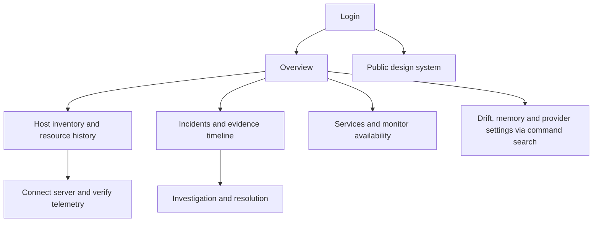

# Interface & UX Design Specification

## Design principles

- **Operational clarity:** show host telemetry, workload state and endpoint checks side by side without conflating them; AI insights are advisory rather than primary source of truth.
- **Evidence is visible:** present both model summary and the diagnostic records it claims to cite.
- **Progressive disclosure:** basic resources first, drill down to diagnostics and memory.
- **Safe defaults:** no auto-remediate button, no raw secret upload, clear provider configuration status.

## Implemented visual system

The canonical visual reference is [root DESIGN.md](../DESIGN.md), extracted from `apps/web/app/tokens.css` and the native React primitives in `apps/web/components/ui.tsx`. Global styling lives in `apps/web/app/globals.css`; `.impeccable/design.json` contains preview and metadata extensions, not a second runtime theme. The backend architecture remains in [docs/BACKEND-DESIGN.md](BACKEND-DESIGN.md).

Color tokens, typography, radii, quarter-rem spacing steps, and layout dimensions are defined in [root DESIGN.md](../DESIGN.md) rather than duplicated here.

### Public component catalog

`/design-system` is available without signing in, including while the Hub is unavailable. Links appear on the loading and login surfaces. Its native controls, swatches, meter slider, form and evidence disclosure use only synthetic examples; the catalog makes no API calls and saves no settings.

Shared controls use native labels and inputs, visible 2px keyboard focus, attributed errors, disabled/busy feedback and reduced-motion overrides. The catalog has a skip link; its section index wraps at 720px and the palette reflows at 1000px and 720px.

The catalog and dashboard preserve the distinction between measured records, advisory AI hypotheses and human-confirmed resolution. A missing/non-finite measurement is unavailable, not a zero-value bar. Status text accompanies semantic color.

## Monochrome workspace and service monitoring boundary

The supplied Pencil design replaces the earlier rail composition. Layout and typography follow [DESIGN.md](../DESIGN.md). Example devices, endpoints, probe periods and organization data from the reference are not embedded in live views.

1. **Overview:** threshold pressure is at or above the limit, within 5 percentage points below it, or within measured limits. Rank by smallest resource headroom; assessment covers only loaded hosts with comparable current readings. Fleet agent counts use the full-fleet totals, and the offline shortcut shows only offline rows among loaded devices. Selecting a device shows its reading, limit, percentage-point margin, separate utilization ratio, sample time, and host history action. Selecting an endpoint in the separate reachability card uses the same inspector for its target, probe location, expected response and latest check, without starting a probe.
2. **Hosts:** the summary counts connected and enrolled agents. The table supports query and status filtering, displays CPU/memory/disk and last contact, and gives a separate resource-risk status. Historical readings stay readable and do not receive live risk color. Host details retain the existing raw resource history, metadata, and related incident link.
3. **Incident investigation:** show open and recently resolved records with an inspector containing recorded timeline and evidence. A host sample is separate from incident-time evidence. Advisory AI and human-confirmed resolutions remain distinct.
4. **Services and setup:** use a separate Services destination and Add service capability state. No configured monitor, probe result or service process state is fabricated. Connect server guides the operator through configuration, pinned installation, and checking the selected agent's connectivity and sample freshness.

### Independent signal contract

| Signal | Source and required context | Meaning / unavailable behavior |
|---|---|---|
| Agent connectivity | Hub connection/last-seen state and timestamp | `Online` or `Offline`; connection is not application health. Retained samples must be labeled historical/stale. |
| Host utilization | Agent sample, units and observation time | CPU, memory and disk describe the host, not the selected service. Missing samples use `—` with `No measurement`; stale samples never look live. |
| Workload process | Supported, explicitly enabled read-only Docker/systemd inventory and collection time | `Running`/`Active`, `Stopped`/`Failed`, or `Unknown`; process state does not prove that an endpoint responds. |
| Workload resources | Per-workload measurement and scope | Separate service CPU/memory from host percentages. Missing capability, denied permission or unsupported runtime is unavailable, not zero. |
| Endpoint reachability | Independent HTTP check from a named probe, target, time, expected response and observed result/error | `Up`, `Down`, `Unknown` or `Not configured`; only a fresh failed check establishes `Down`. Timeout, DNS and TLS failures have explicit reasons. |
| Root cause | Cited investigation or human resolution | Default `No root cause inferred`. Temporal overlap alone is not causality; AI hypotheses and human-confirmed resolutions remain separately labeled. |

`Not configured` means no endpoint is associated with that service. `Unknown` means a configured check has no usable/fresh result. Multiple endpoints show `up / configured` plus failing/unknown counts as needed; details enumerate the checks rather than choosing an arbitrary result. Reachability is always from the displayed probe location, not a promise of global availability.

In Overview, endpoint lists distinguish loading, unavailable and confirmed empty. A configured monitor without a usable result is pending; a result aged 60 seconds or more is stale. The Worker makes a monitor eligible after 15 seconds, so the 60-second freshness window tolerates polling and queue delays without promising a check cadence. Stale results retain their original check time and historical outcome, but do not count as current up or down. Aging is independent of page refresh and fleet sample freshness.

The reference case must remain representable: `web-01` has high host CPU; `storefront-api` is running but its endpoint returns HTTP 503; `backup-01` has an offline agent but two independently successful endpoint checks; `node-exporter` has no configured endpoint. None of these observations establishes a root cause.

### Selection and real actions

- Host selection updates history and metadata by stable identity. If a refresh removes the selection, clear it and explain the removal. Failed refreshes retain labeled cached values.
- Use an accessible control for selection and an explicit current/pressed state. Refresh must not steal focus.
- Search/filter shows matches and a clear action. Distinguish no matching hosts, no enrolled hosts and an API failure.
- `Connect server` uses the existing single-use enrollment API. `Add service` cannot save anything without a validated target, a supported probe and persisted monitor configuration.
- Opening host history or incident detail does not start an AI investigation or a diagnostic.
- Overview's pressure inspector only attaches an incident matching the selected host and resource category. Its advisory card identifies the source incident and opening time; a recorded hypothesis does not assess the current sample. Loading, an unavailable detail read, a successful absence of investigations, and a recorded status are distinct.
- Provider settings report server-side configuration only; no provider keys or enrollment credentials enter public reference examples or ordinary inspector content.

### Charts, freshness and responsive states

- Resource history has a 0–100% scale, actual timestamps/timezone, window and aggregation. Each bar represents one raw sample; CPU/memory/disk buttons select the measured series. Never stretch a handful of samples into a fictitious 30-minute history; missing intervals remain empty. Accessible chart descriptions and per-observation titles provide measurement context.
- Display the actual alert rule. The starter uses two consecutive high samples and a 15-minute cooldown; the image's ≥80% for 10 minutes is an example, not an implemented policy. Metric color is not proof that an incident was opened.
- RX/TX rates require counter deltas over an observed interval, correct units and reset handling. Current byte counters cannot be labeled MiB/s directly. OS/capacity, per-service resources and probe metadata remain unavailable until collected.
- Show sample/check timestamps independently. A page refresh timestamp does not make old telemetry or endpoint results fresh; staleness thresholds must come from the implemented collection policy.
- Wide Overview and Incidents use a contextual right pane. In Overview the watchlist and endpoint card share the left column. The full-height inspector pins as one card at the top until the workspace ends, without an internal scrollbar. On narrow screens the watchlist, endpoint card and inspector stack in that order without pinning. The full-width inventory follows, and selecting a row moves focus to its details. Preserve host-table headers, keyboard access, status and freshness in a named horizontal scroll region. Dock destinations keep their labels on mobile.
- Loading, no hosts, no matches, no service selected, unsupported/denied inventory, no endpoint, check pending/stale, offline agent and partial fetch failure each need explicit copy. Do not replace these with the same “All healthy” or “No data” state.

### Delivery boundary

Hosts and Services show one explicitly configured systemd unit on the selected host. The original observation time and freshness are visible; disabled, not reported, unsupported and failed collection are not process states. Broader workload inventory, scheduled HTTP probes and a probe-location registry remain in the [Roadmap](ROADMAP.md#fleet-services-dashboard-delivery-planned). Existing manual endpoint checks remain separate. Never fill missing production APIs with demo records.

## Implemented navigation map

The workspace header shows the local scope, command search and admin controls. A fixed bottom dock shows Overview, Services, Hosts and Incidents; its plus action opens Add service. Setup pages keep the global header and use back links rather than the dock.

### Command palette

Open **Jump to…** in the header, use the desktop dock search, or press `Ctrl+K` / `Cmd+K` from any signed-in dashboard view. The mobile header keeps an icon-only search button. Search loaded hosts by name or ID, loaded incidents by title, and every workspace destination by name or keyword. Use the filters to narrow results. Up to three recently opened host or incident results replace suggestions for the current dashboard session.

Use `↑` / `↓` to select, `Enter` to open, and `Esc` to dismiss and return focus. Host and incident results focus the existing inspector or detail. Quick actions open Connect server, Provider settings, and Incident memory without submitting forms or generating an enrollment token. The **Services** filter links to the Services page, which shows the selected host's configured systemd unit and endpoint checks. It does not search individual units or endpoints.

## Implemented screens / states

### Login
Admin password only, error feedback, warning when keys absent. Login is separate from agent enrollment.

### Overview and Hosts
The Overview compares fresh online resource observations against the limits reported by the Hub. Agent online and offline counts cover the fleet; threshold counts cover only the assessed subset of loaded hosts. Offline rows show last agent contact when known; disconnected, online with a stale sample, online without a sample, and cached do not imply current readings. Hosts keeps historical values and raw timestamped history, not interpolated points. The watchlist inspector opens history for the selected resource. Fleet polling continues outside Hosts, but selected host history fetches and polls only while Hosts is open; leaving aborts any pending history read.

### Incident detail
Open and resolved queues share an inspector with host context, a measured evidence timeline, explicit AI investigation and human-confirmed resolution. A latest host sample is not an incident-time measurement; no endpoint impact is inferred.

### Incident memory
Simple FTS query, prior confirmed resolution list. A later UI should show which previous case was retrieved, how similar, and provenance/recency.

### Enrollment
`Connect server` reviews pinned installation configuration, generates a one-time command, then verifies real connectivity and telemetry for the operator-selected host. The host list does not link IDs to token issuance. Expiry and leaving the install step clear the visible command but do not revoke the token or erase shell history/clipboard copies.

### Provider settings
Manage stored provider connections and run explicit synthetic connection tests. Stored keys are never returned to Web. Opening settings or inspecting a host does not call a model.

## Core UX acceptance tests

1. A user without login sees password form; protected endpoints respond 401.
2. First-time admin can generate token and add a host without database knowledge.
3. Offline host is visibly distinct; no fake 'live' metrics.
4. Investigation is disabled until a provider key is configured.
5. Queued, failed and completed AI reports have different visual states.
6. AI report never presents hypothesis as human-verified resolution.
7. Resolving an incident makes it appear in memory search.
8. Layout remains usable on 700px screens (verify actual browser).

## Future UX work

The complete Fleet & services target remains planned until its workload/endpoint data and safety gates are met; the implemented host-only slice is not proof of those capabilities. Other future work: incident timeline, key management, approval/consent for evidence sharing, notifications, comprehensive keyboard and screen-reader audits, timezone options and localization. Native keyboard controls, visible focus, skip links, invalid-field feedback and reduced-motion handling are already implemented; broader accessibility verification remains future work.

## Brand & Logo Assets

OpsPilot uses the **Horizon Gauge** mark: a cockpit attitude bezel bridged by a 45° horizon chevron representing baseline stability and deterministic system drift (*"Evidence before inference"*). Color values follow [root DESIGN.md](../DESIGN.md#colors).

| Asset / Surface | Location | Purpose |
| --- | --- | --- |
| Symbol (light / dark) | [`opspilot-symbol-color.svg`](assets/logo/opspilot-symbol-color.svg), [`opspilot-symbol-color-dark.svg`](assets/logo/opspilot-symbol-color-dark.svg) | Master standalone vector marks for light and dark surfaces |
| Horizontal lockup (light / dark) | [`opspilot-horizontal-color.svg`](assets/logo/opspilot-horizontal-color.svg), [`opspilot-horizontal-dark.svg`](assets/logo/opspilot-horizontal-dark.svg) | Master wordmark + symbol lockups |
| Inline UI component | [`apps/web/components/brand-mark.tsx`](../apps/web/components/brand-mark.tsx) | React SVG symbol rendered in the workspace header and auth surfaces |
| Web & PWA icons | [`apps/web/public/`](../apps/web/public/) | `favicon.ico`, `favicon.svg`, `apple-touch-icon.png`, `icon-192.png`, `icon-512.png`, `maskable-512.png`, `site.webmanifest` |

### Clear space, sizing, and usage rules

- **Clear space:** keep a minimum clear zone of **1 × bezel wall width** (¼ of symbol width) around the logo on all sides.
- **Minimum sizes:** **16 px** for the symbol/favicon (`favicon.ico` / `favicon.svg`), **112 px wide** for the horizontal lockup.
- **Light-background contrast:** never place `#52D9B7` mint directly on white (`~1.75:1` contrast); use Deep Mint `#0E8A6D` (`~4.28:1`) for the light-mode/print horizon chevron while keeping the rest of the palette aligned with [root DESIGN.md](../DESIGN.md#colors).
- **Don'ts:** do not stretch, squash, rotate, or alter the 45° horizon angle; do not recolour outside the navy/mint/monochrome palette or add shadows, glows, or gradients; do not rearrange or resize the symbol relative to the `OpsPilot` wordmark, or retype the wordmark in a stock font.
