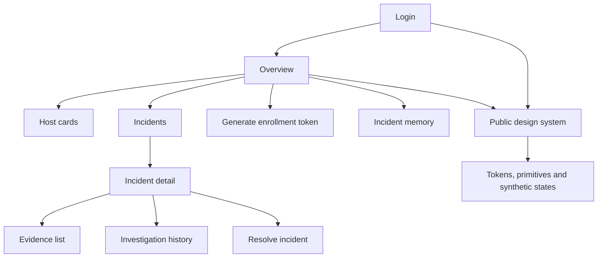

# Interface & UX Design Specification

## Design principles

- **Operational clarity:** show host health and incidents first; AI insights are advisory rather than primary source of truth.
- **Evidence is visible:** present both model summary and the diagnostic records it claims to cite.
- **Progressive disclosure:** basic resources first, drill down to diagnostics and memory.
- **Safe defaults:** no auto-remediate button, no raw secret upload, clear provider configuration status.

## Implemented visual system

The canonical visual reference is [root DESIGN.md](../DESIGN.md), extracted from `apps/web/app/tokens.css` and the native React primitives in `apps/web/components/ui.tsx`. Global styling lives in `apps/web/app/globals.css`; `.impeccable/design.json` contains preview and metadata extensions, not a second runtime theme. The backend architecture remains in [docs/DESIGN.md](DESIGN.md).

| Token | Value / use |
|---|---|
| Canvas | `#090f18` |
| Surfaces | `#101824` panel, `#111e2d` raised control, `#091421` input |
| Borders | `#233449` structural, `#526b82` interactive |
| Accent | `#52d9b7`, hover `#79efd3`, foreground `#092521` |
| Success | `#75dec1` on `#142e2a` |
| Warning | `#e9ba78` on `#302719` |
| Danger | `#ffb4a7` on `#371c22` |
| Information | `#a5c9f5` on `#182a40` |
| Text | `#e8edf5`, secondary `#a3b4c7` |
| Body | system UI sans, 14px at the 16px root; monospace for code and measurements |
| Radius | 6px controls, 10px nested surfaces, 14px panels |
| Spacing | quarter-rem steps: 1–8, 10, 12 |
| Layout | 240px left rail in normal flow; columns stack at 1100px, navigation moves above content at 700px |

### Public component catalog

`/design-system` is available without signing in, including while the Hub is unavailable. Links appear on the loading/login surfaces and in dashboard navigation. It is a self-contained reference with synthetic evidence, semantic swatches, actual shared primitives, a keyboard-operated meter slider, local form validation, disabled/loading examples and an evidence disclosure. It makes no API calls and does not persist settings or expose production telemetry. The local form explicitly reports that no settings were saved.

Shared controls use native labels and inputs, visible 2px mint keyboard focus, explicit error descriptions and invalid states, disabled/busy feedback, and reduced-motion overrides. The catalog adds a skip link and section anchors; its sticky index becomes wrapping inline links at 720px, while its four-column palette becomes three columns at 1000px and two at 720px. These implemented provisions do not claim a completed screen-reader audit.

The catalog and dashboard preserve the distinction between measured records, advisory AI hypotheses and human-confirmed resolution. A missing/non-finite measurement is unavailable, not a zero-value bar. Status text accompanies semantic color.

## Navigation map

## Screens / states

### Login
Admin password only, error feedback, warning when keys absent. Login is separate from agent enrollment.

### Overview
Summary cards (`managed hosts`, `open incidents`, `configured AI providers`), host list with CPU/RAM/disk bars, incident list, generate enrollment token, manual test incident form. Refresh every 10 seconds. Empty state explains enrolling first agent.

### Incident detail
Host/category/status, timestamp, evidence source/content, provider selection, async investigation status, diagnosis and evidence IDs, resolution input. Measured records, advisory AI hypotheses and human-confirmed resolution are separately labeled. Clickable evidence-ID anchors, model/cost, safety warnings and evidence freshness remain future work.

### Incident memory
Simple FTS query, prior confirmed resolution list. A later UI should show which previous case was retrieved, how similar, and provenance/recency.

### Enrollment
Show one-time token once, expiration, binary+container installation instructions, warnings for remote HTTPS/WSS, server-specific allowlist. Starter shows token but not host-specific install command builder.

## Core UX acceptance tests

1. A user without login sees password form; protected endpoints respond 401.
2. First-time admin can generate token and add a host without database knowledge.
3. Offline host is visibly distinct; no fake 'live' metrics.
4. Investigation is disabled until a provider key is configured.
5. Queued, failed and completed AI reports have different visual states.
6. AI report never presents hypothesis as human-verified resolution.
7. Resolving an incident makes it appear in memory search.
8. Layout remains usable on 700px screens (verify actual browser).

## Future UX work

Incident timeline, charts with actual time axes, per-service dashboards, agent health, key management, approval/consent for evidence sharing, notifications, cross-host view, comprehensive keyboard and screen-reader audits, timezone options and localization. Native keyboard controls, visible focus, skip links, invalid-field feedback and reduced-motion handling are already implemented; broader accessibility verification remains future work.
